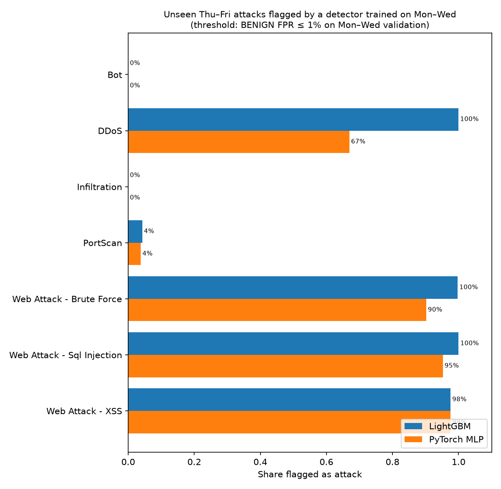

# Detection: LightGBM vs PyTorch MLP

Generated by `uv run ae compare` from `reports/*_metrics.json`. Test set: stratified 15% of de-duplicated CIC-IDS2017 (same rows for both models). Both use the same decision rule, threshold rule (BENIGN FPR ≤ 1% on validation, lowest threshold within 0.003 of the best validation macro-F1) and isotonic calibration.

## Headline (test set, at each model's threshold)

| Model | Macro-F1 | Macro-F1 (attacks) | BENIGN FPR | Attack detection | Brier (cal.) | Mean PR-AUC | Threshold | Size | Train time (final fit) | Latency / alert (median) | Batch rows/s |
|---|---|---|---|---|---|---|---|---|---|---|---|
| LightGBM | 0.9716 | 0.9669 | 0.098% | 99.96% | 0.00148 | 0.9861 | 0.2200 | 143 rounds × 7 trees | 156 s | 0.49 ms | 53,460 |
| PyTorch MLP | 0.9338 | 0.9229 | 0.105% | 99.49% | 0.00266 | 0.9318 | 0.4976 | 60,231 parameters | 90 s | 1.72 ms | 74,148 |

Training device: LightGBM on CPU; MLP on `mps`. Latency is CPU-only for both, single row, including preprocessing and calibration for the MLP.

## Per family (test F1 / recall)

| Family | Test rows | F1 LGBM | F1 MLP | Recall LGBM | Recall MLP | Precision LGBM | Precision MLP |
|---|---|---|---|---|---|---|---|
| BENIGN | 314,294 | 0.9995 | 0.9990 | 0.9990 | 0.9990 | 0.9999 | 0.9990 |
| DoS | 29,062 | 0.9987 | 0.9958 | 0.9997 | 0.9937 | 0.9977 | 0.9980 |
| DDoS | 19,202 | 0.9999 | 0.9998 | 1.0000 | 0.9998 | 0.9998 | 0.9998 |
| PortScan | 13,604 | 0.9948 | 0.9947 | 0.9993 | 0.9992 | 0.9904 | 0.9903 |
| BruteForce | 1,373 | 1.0000 | 0.9949 | 1.0000 | 0.9949 | 1.0000 | 0.9949 |
| WebAttack | 321 | 0.9953 | 0.9585 | 0.9969 | 0.9720 | 0.9938 | 0.9455 |
| Bot | 292 | 0.8130 | 0.5939 | 0.9452 | 0.5959 | 0.7132 | 0.5918 |

Held-out families (never trained on), share flagged as an attack:

| Label | Rows | LGBM | MLP |
|---|---|---|---|
| Heartbleed | 11 | 0% | 0% |
| Infiltration | 36 | 0% | 0% |

## Ablation: MLP loss function (same config, full training set)

The deployed variant is chosen on validation macro-F1 at threshold; test numbers are reported for both.

| Loss | Class weights | Val macro-F1 @thr | Test macro-F1 | Test BENIGN FPR | Test Bot F1 | Best / run epochs | Train time |
|---|---|---|---|---|---|---|---|
| cross-entropy | none | 0.9292 | 0.9296 | 0.169% | 0.5788 | 7/20 | 87 s |
| focal (γ = 2.0) ✓ | none | 0.9348 | 0.9338 | 0.105% | 0.5939 | 15/20 | 90 s |

## MLP hyperparameter grid (validation macro-F1, argmax)

Trained on all attack rows + 300,000 sampled BENIGN rows.

| Hidden | Dropout | LR | Weights | Val macro-F1 | Best epoch | Time |
|---|---|---|---|---|---|---|
| 256-128-64 | 0.20 | 0.003 | sqrt | 0.8458 | 18 | 45 s |
| 256-128-64 | 0.20 | 0.001 | sqrt | 0.8483 | 18 | 37 s |
| 256-128-64 | 0.20 | 0.01 | sqrt | 0.8472 | 18 | 34 s |
| 256-128-64 | 0.10 | 0.003 | sqrt | 0.8560 | 16 | 33 s |
| 256-128-64 | 0.20 | 0.003 | balanced | 0.7419 | 19 | 34 s |
| 256-128-64 | 0.20 | 0.003 | none | 0.9324 | 15 | 33 s |
| 512-256-128 | 0.20 | 0.003 | sqrt | 0.8463 | 18 | 58 s |

## Cross-day robustness (binary, train Mon–Wed → test Thu–Fri)

No attack family occurs on both sides of the split, so every Thu–Fri attack is a type the detector never saw. The threshold gives BENIGN FPR ≤ 1% on Mon–Wed validation.

| Model | Mon–Wed detection (seen types) | Mon–Wed BENIGN FPR | Thu–Fri AUROC | Thu–Fri detection (unseen types) | Thu–Fri BENIGN FPR |
|---|---|---|---|---|---|
| LightGBM | 100.00% | 0.998% | 0.8586 | 60.11% | 1.482% |
| PyTorch MLP | 99.99% | 1.000% | 0.8590 | 40.89% | 1.042% |

Unseen attack types, share flagged:

| Label | Rows | LightGBM | PyTorch MLP |
|---|---|---|---|
| Bot | 1,948 | 0.0% | 0.0% |
| DDoS | 128,014 | 100.0% | 66.9% |
| Infiltration | 36 | 0.0% | 0.0% |
| PortScan | 90,694 | 4.2% | 3.8% |
| Web Attack - Brute Force | 1,470 | 99.7% | 90.2% |
| Web Attack - Sql Injection | 21 | 100.0% | 95.2% |
| Web Attack - XSS | 652 | 97.5% | 97.5% |

## Figures

- `figures/lgbm_confusion_matrix.png`, `figures/mlp_confusion_matrix.png`
- `figures/lgbm_pr_curves.png`, `figures/mlp_pr_curves.png`
- `figures/mlp_training_curves.png` (validation log-loss and macro-F1 per epoch, CE vs focal)
